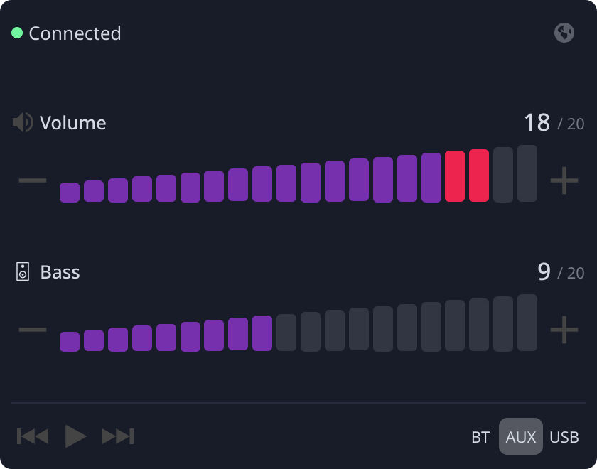

# Z407 Remote for KDE Plasma

A system tray widget that controls the **Logitech Z407** speaker's own volume and bass over Bluetooth Low Energy, the same channel the speaker's wireless control pod uses. It does not touch your system volume.

<p align="center">
  
</p>

- Click or drag on the level meters to set volume and bass, or use the − and + buttons
- Scroll on the tray icon to change the speaker volume, middle-click to play or pause
- Previous, play/pause, next
- Switch the input between Bluetooth, AUX and USB
- Levels 17 to 20 are drawn in red as a loudness warning

<p align="center">
  
</p>

## Requirements

- Linux with BlueZ and a Bluetooth adapter that supports Bluetooth Low Energy
- KDE Plasma 6
- [uv](https://docs.astral.sh/uv/). It installs a suitable Python version on its own.

### Remove the batteries from the control pod

The speaker accepts only one BLE remote at a time. While the control pod is powered, it holds that connection and your computer cannot connect. Take the batteries out of the pod before you install the widget.

Audio is separate from this connection. You can keep using the speaker as a regular Bluetooth audio device, or through AUX or USB, while the widget controls it.

## Install

```bash
git clone https://github.com/mertemr/z407-plasma-remote.git
cd z407-plasma-remote
./install.sh
```

The script installs the Python dependencies into a local `.venv`, starts the `z407d` user service and adds the widget to the system tray. Run it again after `git pull` to update.

The service finds the speaker by scanning. To skip the scan, pass the speaker's BLE address. You can find it in `journalctl --user -u z407d` after the first connection.

```bash
./install.sh D3:81:93:F8:00:F3
```

If the icon does not appear, open **System Tray Settings → Entries** and set **Z407 Remote** to **Always shown**.

## Syncing the levels

The speaker never reports its current volume or bass, so the widget cannot read them. It tracks every change it makes instead.

1. After installation, both meters show `?`.
2. Click the bar for the level you want. The service steps the speaker all the way down to the minimum, then up to that level. This takes a few seconds. **The speaker goes quiet for a moment during volume syncing, then comes back at the chosen level.**
3. From then on the meters stay accurate, including across reboots. The tracked levels are saved in `~/.local/state/z407/levels.json`.

If you change the volume or bass in any other way, for example with the control pod, the meters no longer match the speaker. Right-click the tray icon, choose **Reset volume and bass levels…** and confirm. The next adjustment syncs again from the minimum.

If a meter shows 20 but the speaker sounds quieter than its maximum, keep pressing +. The extra steps still reach the speaker, which stops at its real limit while the meter stays at 20. The same works with − at 0.

## Technical limitations

- **No level readback.** The protocol has no command that returns the current volume or bass. The speaker also confirms every step, even past its limits, so the limits cannot be detected either. Levels are tracked by counting steps.
- **One remote at a time.** The control pod and the computer cannot both be connected. Using the pod while the widget is in use also puts the meters out of sync.
- **Volume steps are approximate.** Bass has 20 real steps and maps one to one. Volume has about 32 real steps, and the lower half is barely audible, so the 20 volume levels follow a curve. The values are `VOL_RAW_MAX` and `VOL_CURVE` in [`z407_remote/protocol.py`](z407_remote/protocol.py) if your unit behaves differently.
- **Idle disconnect.** The speaker drops an idle BLE connection after about five minutes. The next action reconnects automatically, which takes around three seconds.
- **Input status.** The speaker does not always confirm an input switch, so the highlighted input is the one last selected from the widget.
- **Linux only.** The service uses BlueZ through [bleak](https://github.com/hbldh/bleak) and the widget needs Plasma 6.

## Command line

The installer also adds `z407ctl` to `~/.local/bin`. It talks to the same service, so you can bind it to keyboard shortcuts.

```bash
z407ctl status
z407ctl vol_set 12
z407ctl bass_down
z407ctl src_aux
```

Run `z407ctl --help` for the full list. Every command prints the service status as JSON.

## Troubleshooting

| Problem | Fix |
|---|---|
| "Service not running (z407d)" | `systemctl --user status z407d` and `journalctl --user -u z407d` |
| "Could not connect" | Check that the pod has no batteries and the speaker is on, then press the connect button in the panel |
| Connect keeps failing after a crash | `bluetoothctl disconnect <address>`, then `systemctl --user restart z407d` |
| Meters do not match what you hear | Reset the levels from the right-click menu and sync again |

## Uninstall

```bash
./uninstall.sh
```

## Protocol

| Action | Write to `c2e758b9-…` | Notification on `b84ac9c6-…` |
|---|---|---|
| Handshake | `8405`, then `8400` after `d40501` | `d40001`, `d40002` or `d40003` |
| Bass up / down | `8000` / `8001` | `c000` / `c001` |
| Volume up / down | `8002` / `8003` | `c002` / `c003` |
| Play/pause, next, previous | `8004`, `8005`, `8006` | `c004`, `c005`, `c006` |
| Input Bluetooth / AUX / USB | `8101` / `8102` / `8103` | `c101`–`c103`, sometimes `cf04`–`cf06` |

The GATT service is `0000fdc2-0000-1000-8000-00805f9b34fb`. Volume and bass are separate commands. The pod's bass mode exists only because it has a single dial.

## License

[MIT](LICENSE). This project is not affiliated with or endorsed by Logitech.
